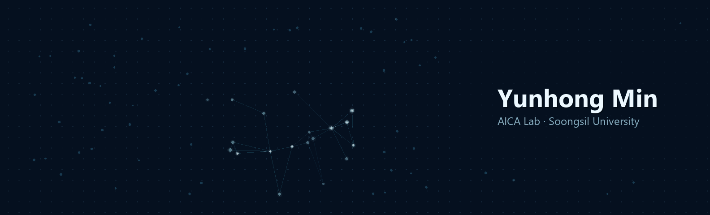

  

  
  

## About Me

I am an undergraduate student at **Soongsil University** and a Undergrad Researcher at **Advanced Intelligent Computing Architecture(AICA) Laboratory**.  
My interests lie in **AI optimization** and **Solving Everyday's Problem with Tech**, with a focus on building practical solutions.

- Studying and researching AI optimization
- Working primarily with Python, especially PyTorch
- Exploring software development across web, systems, and mobile platforms

## Tech Stack

  
  
  
  
  
  

## Selected Projects

- [**MD-Note**](https://apps.apple.com/kr/app/md-note/id6785716593) - Ver 3.0 Published! / Can Use in Ipad!
- [**Atrataa Harness**](https://github.com/myunhh/Strataa) - New! / Harness For Research on omp with ARIS
- [**Scaffolding Learn**](https://github.com/Scaffolding-Learn) - New! / Coding With AI, Learning Through AI
- [**GeneUI**](https://github.com/myunhh/GeneUI)
- **And Other Side Project / Researchs**

## My Token Usage

## GitHub Stats

  
  

